<!-- ARQUIVO GERADO / GENERATED FILE — edite/edit content/en.md e rode/run `npm run build:readme` -->

🇧🇷 [Português](README.md) | 🇺🇸 **English**

# Camila L. Oliveira

Teacher, Physics undergraduate, writer, and developer.

 

---

## Tech Classroom

I teach technology through project-based learning, combining web development, mobile development, databases, Git, collaboration, and responsible artificial intelligence.

| Paths | Experiences | Skills |
|:---:|:---:|:---:|
| Web Development | HTML, CSS, and JavaScript labs | Logic and problem solving |
| Mobile Development | Android prototypes and real-world apps | UX, accessibility, and testing |
| Databases | Modeling, queries, and data for decisions | Organization and analytical thinking |
| Git and collaboration | Team projects with issues and pull requests | Collaboration and authorship |
| Artificial Intelligence | Critical experimentation and AI projects | Ethics, security, and creativity |

---

  
<h2>About Me</h2>

I have worked in software development since 2019, creating features for Itaú and PagBank — solutions for e-commerce, financial education, payments, communications, and analytics. My team won second place at HackaPag in June 2022 with a financial education project.

I hold a lato sensu postgraduate degree in Artificial Intelligence from TIDD/PUC-SP, with the article *"Consumerism, Morality and Excesses of the Digitalised Society"*.

I have a degree in Systems Analysis and Development from FATEC-SP and in Public Administration from UFOP. I speak Portuguese, English, and French.

### Education

- Physics undergraduate degree — **USP** *(in progress)*
- Postgraduate degree in Artificial Intelligence — **PUC-SP (TIDD)**
- Technology degree in Systems Analysis and Development — **FATEC-SP**
- Bachelor's degree in Public Administration — **UFOP-MG**

### Experience

- Senior IT Teacher — Centro Paula Souza
- Android Mobile Engineer — Itaú, PagBank
- Android Trainee/Junior/Mobile Developer — TCS and Itaú
- Mobile Development and Public Administration internships

### Certifications

- [Develop GenAI Apps with Gemini and Streamlit — Google Cloud](https://www.credly.com/badges/c6fa014c-d1da-4fea-a1b3-1385f3df5301/public_url)
- [Intro to Git — Microsoft Learn](https://learn.microsoft.com/api/achievements/share/pt-br/CamilaLOliveira-7670/3ZBGLFZH?sharingId=29592E91721EFBFD)

---

  
<h2>Technologies and Skills</h2>

**Version Control**

**Frontend**

**Backend**

### GitHub Stats

----

  
<h2>Camila's Updates</h2>

### Recent activity

<!--RECENT_ACTIVITY:start-->
1. Pushed undefined commit(s) to [clcmo/ariston](https://github.com/clcmo/ariston) 
2. Pushed undefined commit(s) to [clcmo/Mi_Music](https://github.com/clcmo/Mi_Music) 
3. Pushed undefined commit(s) to [clcmo/Mi_Music](https://github.com/clcmo/Mi_Music) 
4. Pushed undefined commit(s) to [clcmo/GasolinaEtanol](https://github.com/clcmo/GasolinaEtanol) 
5. Pushed undefined commit(s) to [clcmo/urban-neon-clean-theme](https://github.com/clcmo/urban-neon-clean-theme) 
<!--RECENT_ACTIVITY:end-->

### On the blog
<!-- BLOG:START -->
- [A vida é… uma caixinha de som?](https://camilaloliveira.com/fala-mi/a-vida-e-uma-caixinha-de-som/)
- [Eu, os cadernos e os notebooks](https://camilaloliveira.com/fala-mi/eu-os-cadernos-e-os-notebooks/)
- [Uma nota rapida](https://camilaloliveira.com/fala-mi/uma-nota-rapida/)
- [Pergunta da Rodada #3](https://camilaloliveira.com/fala-mi/pergunta-da-rodada-3/)
<!-- BLOG:END -->

### On YouTube
<!-- YOUTUBE:START --><table><tr><td width="250px"></td>
<td width="800px"><a href="https://www.youtube.com/watch?v=eT4LP-ROwN4">O que o SUS fez? / Como estruturar uma boa #redacaoenem? | Apprendendo com Camila</a> 09/11/2026</td></tr></table>
<table><tr><td width="250px"></td>
<td width="800px"><a href="https://www.youtube.com/watch?v=73BC6SSTcB0">E se o plano A demorar? Uma reflexão... de @camilaloliveiraofficial</a> 24/09/2026</td></tr></table>
<table><tr><td width="250px"></td>
<td width="800px"><a href="https://www.youtube.com/watch?v=XO1R37CR4Nc">Criando o site de um Gremio Academico com WP | Apprendendo com Camila | GCW</a> 30/08/2026</td></tr></table>
<table><tr><td width="250px"></td>
<td width="800px"><a href="https://www.youtube.com/watch?v=JVBK44bkdAg">A Trajetória Até a USP &lpar;Part. Rosanny Ayres&rpar; | Apprendendo com Camila</a> 03/08/2026</td></tr></table>
<!-- YOUTUBE:END -->

